# LookUp

A push-only "step outside right now" app. The space station overhead in 8 minutes, aurora possible tonight, a Starlink train in 4. No hobby required — just awe on a tap.

Flutter, iOS + Android, one codebase. **Local-first:** pass prediction runs on the phone (SGP4 via `satellite_observer`), alerts are scheduled as local notifications for the next 48 hours, and nothing personal leaves the device. The only server in the roadmap is a tiny Phase-1 push relay for *live* aurora alerts.

Spec and strategy live in the ideas repo: [`app-ideas/look_up_now/spec.md`](https://github.com/brilliant-disruptions/app-ideas/blob/main/look_up_now/spec.md) · [`strategy.md`](https://github.com/brilliant-disruptions/app-ideas/blob/main/look_up_now/strategy.md).

## What's built (MVP skeleton)

| Layer | Status |
|---|---|
| `lib/domain/` — pure Dart: ISS/Starlink pass prediction, Starlink train detection, aurora rules (Kp vs. geomagnetic latitude, Ovation sampling), sun/darkness, direction-in-words, alert planner (lead time, go-now nudge, cloud gating, quiet hours, nightly cap, stable ids) | ✅ unit-tested (`flutter test`) |
| `lib/data/` — Celestrak (OMM JSON), NOAA SWPC (Kp 1-min, 3-day forecast, Ovation), Open-Meteo cloud cover, on-device store | ✅ |
| `lib/services/` — refresh orchestration (fetch → compute → plan → schedule), local notifications, location, WorkManager background refresh | ✅ written, needs device testing |
| `lib/ui/` — onboarding, Now, Upcoming, Settings, Look sheet (compass + timeline + share) | ✅ written, needs device testing |
| Billing (LookUp+) | ✅ `in_app_purchase` (StoreKit 2 / Play Billing), paywall sheet, restore; products `lookup_plus_monthly`, `lookup_plus_yearly`, `lookup_plus_lifetime` must be created in App Store Connect and Play Console. No server-side receipt validation yet |
| Quiet weeks | ✅ next ISS pass up to 30 days out, "Preview an alert" (a full pass in fast-forward with the real notification), and the last 7 nights of real passes with clear/clouded-out from past cloud cover |
| "Did you see it?" feedback | ✅ on the Look sheet after an event, stored on-device |
| Launcher icon | ✅ generated from `assets/icon/` |
| CI | ✅ GitHub Actions: analyze, test, release APK artifact |
| iOS background task registration in `AppDelegate.swift` | ✅ written, unverified on a Mac (no Xcode in the authoring environment) |

## Screens

Rendered from the real widgets with sample data (`flutter test --update-goldens --run-skipped --tags screenshots test/screenshots`):

| Onboarding | Now | Quiet week | Upcoming | Look sheet | Sky finder | Preview | Log | Share cards | Settings | Paywall |
|---|---|---|---|---|---|---|---|---|---|---|
| 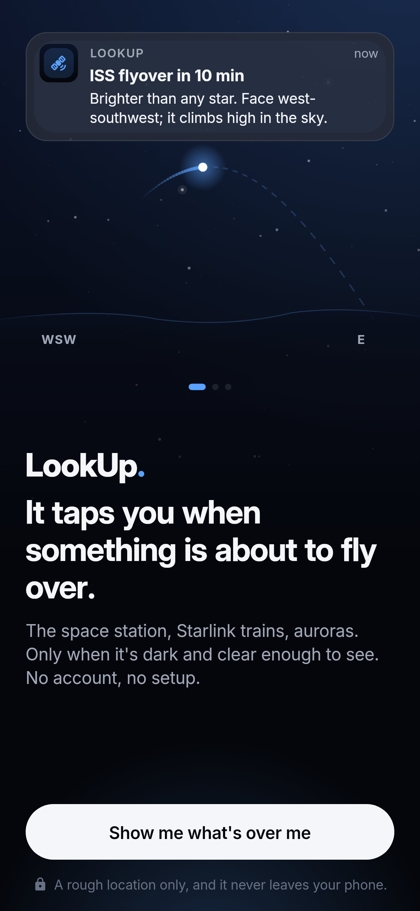 | 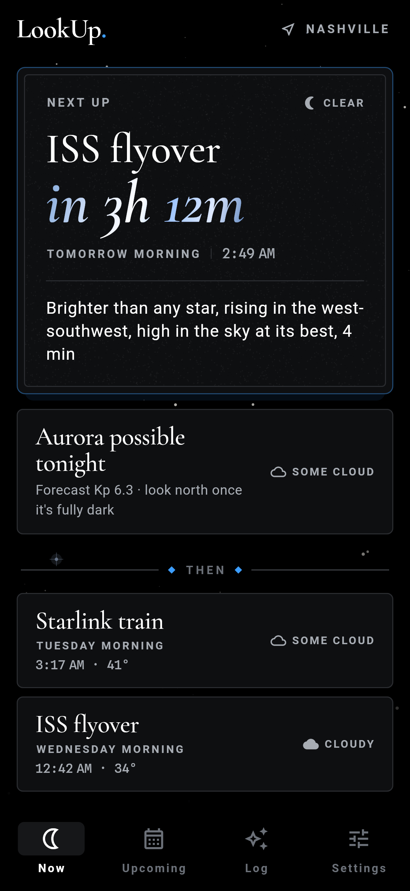 | 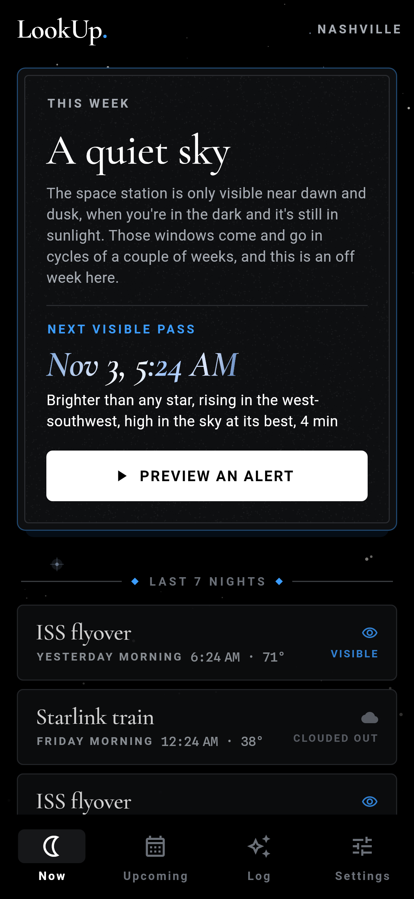 | 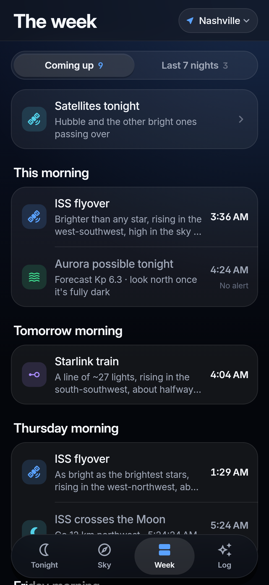 | 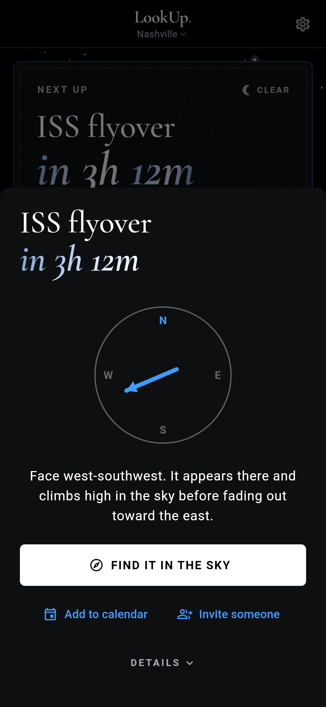 | 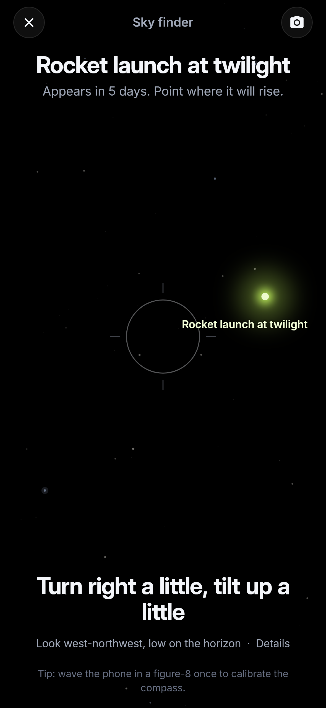 | 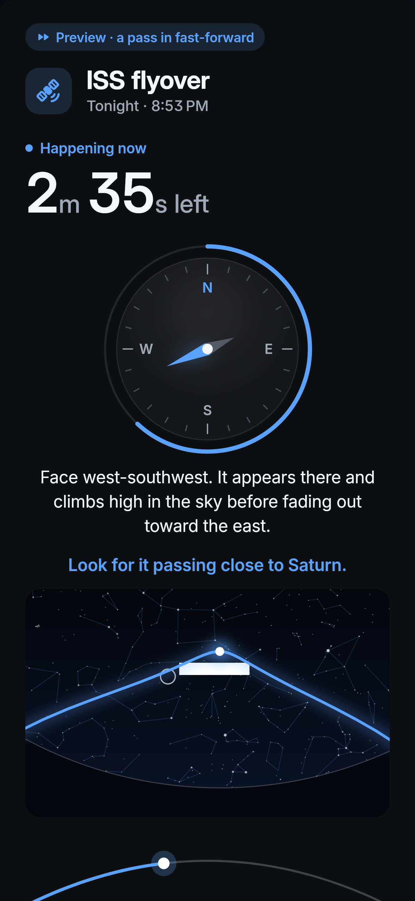 | 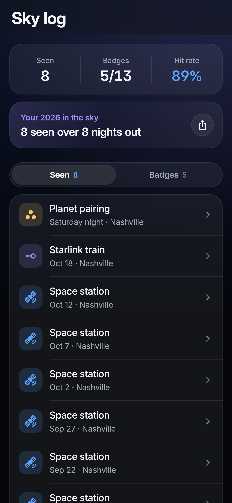 | 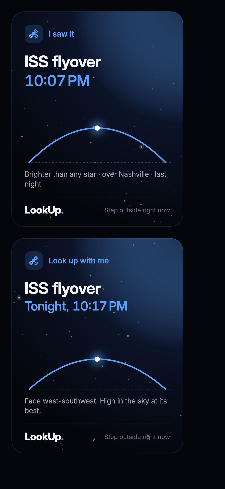 | 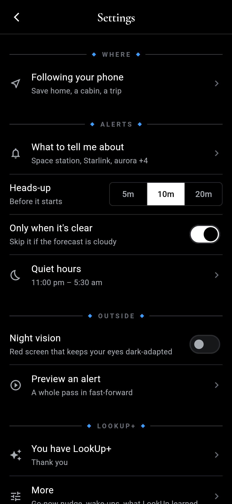 | 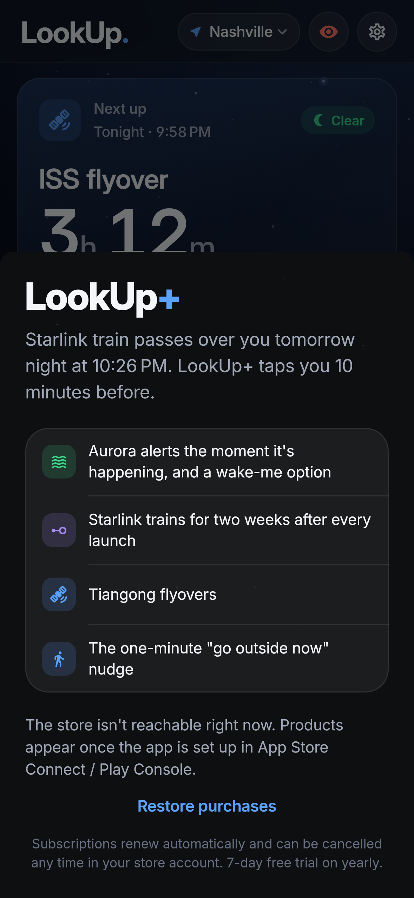 |

## Design

Black, white and one electric blue (SpaceX/Starlink-inspired), dressed with elements borrowed from the Dearly/Woven design system in `app-ideas/bloved/design-system` and translated to night:

| Dearly | LookUp |
|---|---|
| Cormorant Garamond display serif for ceremonial moments | Same face (`assets/fonts`, OFL) for event names, the countdown and stat numerals; italic for the countdown |
| Gold-foil text | `FoilText`: a starlight silver-blue sheen (gold variant kept for share cards) |
| Invitation double-hairline frame | `InviteFrame`: blue outer hairline, grey inner, soft blue glow |
| Paper grain | `Grain`: 4 % film grain on the hero panel |
| Warm paper page | `Starfield`: deterministic stars fading out behind content |
| Ornament rule "— ◆ —" | `OrnamentRule` for section headers |
| StatTile (overline / display value / caption) | `StatTile` for rise / peak / set |
| `.dearly-rise` staggered entrance | `Rise`: 12 px transform-only rise, 70 ms stagger |
| Spline Sans Mono for data | Same face for times and degrees |

All in `lib/ui/fancy/`. Emoji were dropped (Dearly's rule: warmth comes from type, not 🎉).

## Run it

```bash
flutter pub get
flutter test            # domain, services and finder widget tests
flutter run             # iOS simulator or Android emulator
```

### Install on an Android phone

```bash
flutter build apk --release --split-per-abi
adb install build/app/outputs/flutter-apk/app-arm64-v8a-release.apk
```

Or download the `lookup-release-apk` artifact from the latest CI run. The release build is **signed with the debug key** for now (fine for sideloading and testing). Create an upload keystore and a `key.properties` before the first Play Console upload.

### iOS / TestFlight

Xcode Cloud builds every push to `master` and ships to TestFlight. One-time setup: [`docs/testflight-xcode-cloud.md`](docs/testflight-xcode-cloud.md).

Before the first device build:

- **iOS**: `AppDelegate.swift` registers the WorkManager BGAppRefresh task and `Info.plist` declares `BGTaskSchedulerPermittedIdentifiers` = `com.brilliantdisruptions.lookup.refresh` plus the location usage string. This was written against `workmanager_apple` 0.9.11 without an Xcode build; confirm it compiles on first `flutter run` on a Mac.
- **Android**: `AndroidManifest.xml` already has coarse location, notifications, boot receiver (so scheduled alerts survive reboots). Android 13+ asks for notification permission at onboarding.

## Features

- **Alerts** for ISS, Tiangong, Starlink trains, aurora (tonight + now), meteor shower peaks, lunar eclipses, Moon/planet pairings, and rocket launches you can see from where you are. Cloud-gated, quiet hours, nightly cap, learned thresholds from "what got in the way?".
- **Sky finder**: hold the phone up; it tracks the target live (SGP4 + fused rotation sensor + WMM2025 declination) and buzzes when you're on it.
- **Sky log** with badges and a hit rate; **poster share cards** ("I saw it", "Look up with me").
- **Quiet weeks** explain themselves, show the next pass and the last 7 nights; **Preview an alert** plays a full pass in fast-forward.
- **Night vision** mode, large-text support, screen-reader labels.
- **Widgets**: Android home-screen widget with live countdown (built in); iOS widget + Live Activity (sources in `ios/LookUpWidgets`, setup in `docs/ios-widgets.md`).

## Data sources (free, public)

| What | Where | Refresh |
|---|---|---|
| ISS / Tiangong elements | `celestrak.org/NORAD/elements/gp.php?CATNR=25544&FORMAT=json` | daily |
| Starlink catalog + SpaceX supplemental | `…gp.php?GROUP=starlink&FORMAT=json`, `…supplemental/sup-gp.php?FILE=starlink&FORMAT=json` | daily, trimmed to train-phase launches |
| Kp now / 3-day forecast | `services.swpc.noaa.gov/json/planetary_k_index_1m.json`, `…/products/noaa-planetary-k-index-forecast.json` | 30 min |
| Aurora oval | `services.swpc.noaa.gov/json/ovation_aurora_latest.json` | 30 min, sampled at the user's cell |
| Launches | `ll.thespacedevs.com/2.3.0/launches/upcoming` | 6 h |
| Magnetic declination | WMM2025 coefficients, bundled | offline |
| Cloud cover | `api.open-meteo.com/v1/forecast?hourly=cloud_cover` | 6 h — **non-commercial tier**; move to the paid plan when the app charges |

## How an alert happens

1. Refresh (on open if > 3 h old, pull-to-refresh, or the 6-hourly background job) fetches whatever is stale.
2. `EventPipeline` turns cached elements + weather + space weather into the next 7 days of `SkyEvent`s.
3. `AlertPlanner` picks what to push in the next 48 h: enabled types, LookUp+ gating, "only when clear", quiet hours (aurora can override), max 2 per night, lead time, optional go-now nudge.
4. `NotificationService.applyPlan` diffs against what's already scheduled (ids are a hash of the event key) and reschedules. Nothing double-fires; a failed refresh leaves the previous plan standing.
5. "Aurora now" can't be scheduled ahead, so it fires immediately, once per 3-hour bucket.

## Layout

```
lib/
  domain/      pure Dart, no Flutter imports (models, sky, orbit, passes, starlink, aurora, weather, scheduling)
  data/        HTTP clients + LocalStore (shared_preferences)
  services/    EventPipeline, RefreshService, NotificationService, LocationService, background
  state/       Riverpod providers
  ui/          screens + widgets
test/          domain + service tests with real Celestrak fixtures
```
