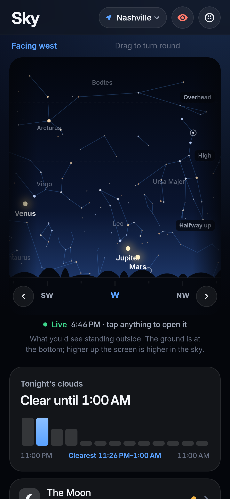
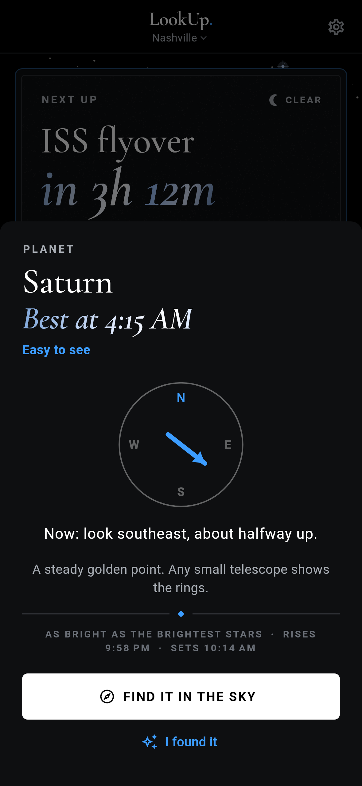
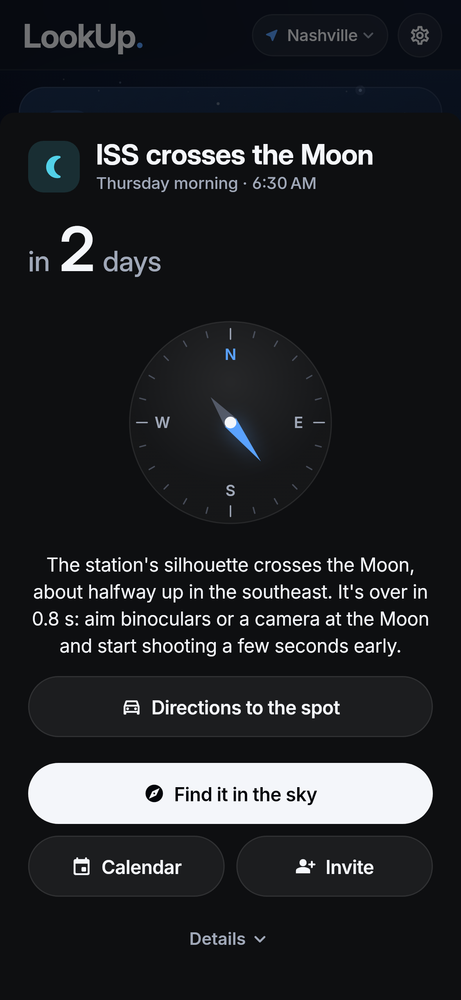
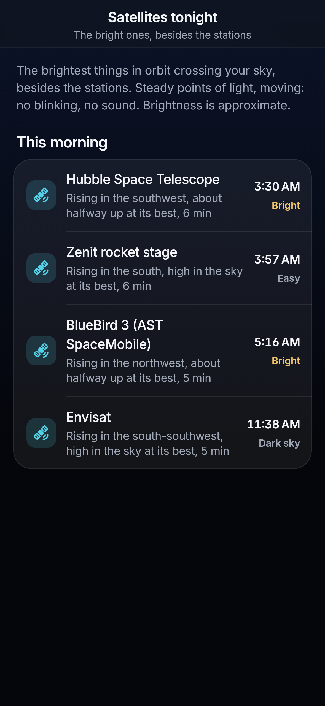
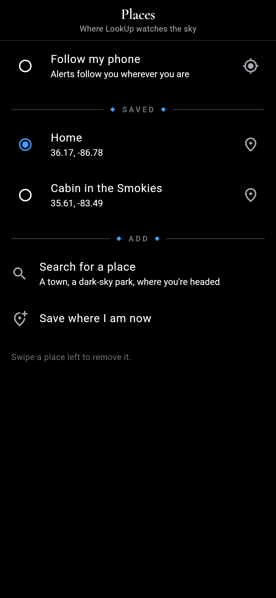
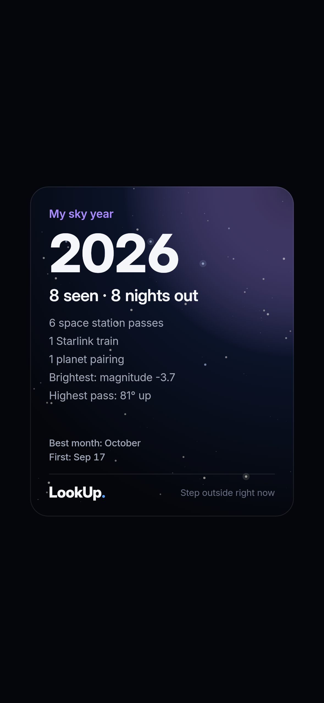
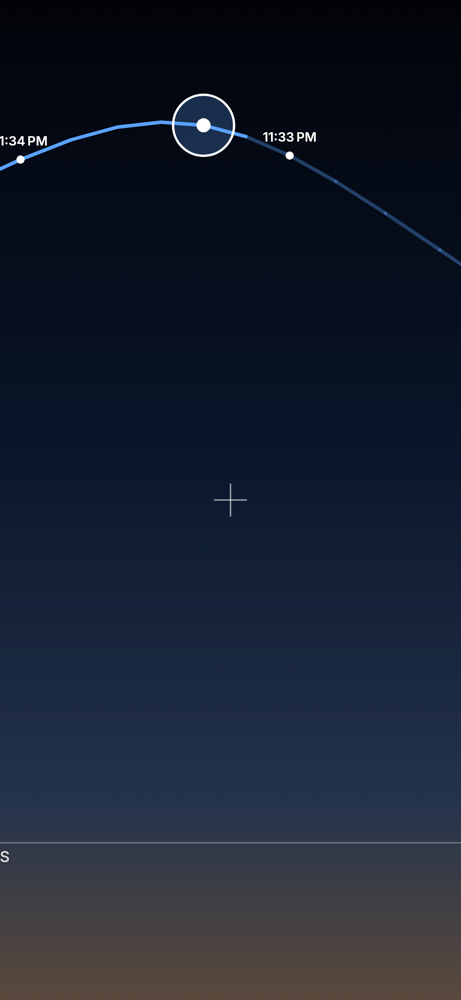
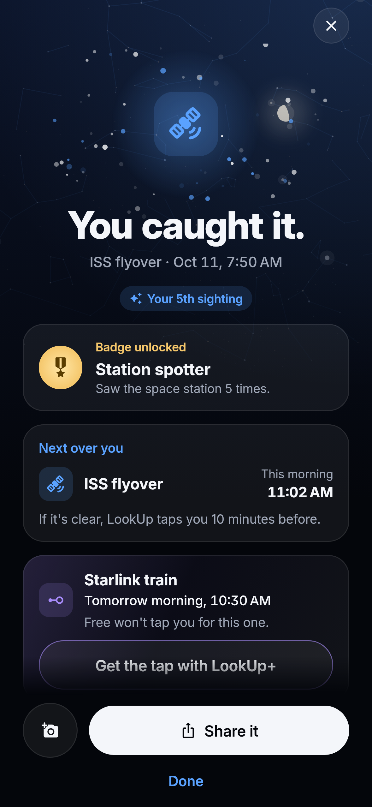
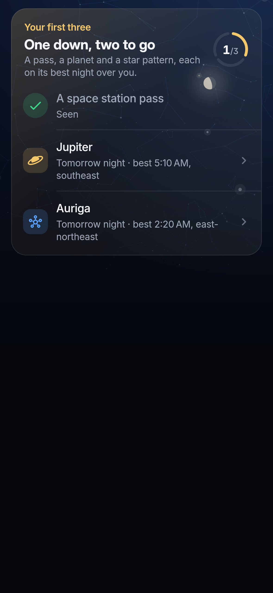

# LookUp

A push-only "step outside right now" app. The space station overhead in 8 minutes, aurora possible tonight, a Starlink train in 4. No hobby required — just awe on a tap.

Flutter, iOS + Android, one codebase. **Local-first:** pass prediction runs on the phone (SGP4 via `satellite_observer`), alerts are scheduled as local notifications for the next 48 hours, and nothing personal leaves the device. The only server in the roadmap is a tiny Phase-1 push relay for *live* aurora alerts.

Spec and strategy live in the ideas repo: [`app-ideas/look_up_now/spec.md`](https://github.com/brilliant-disruptions/app-ideas/blob/main/look_up_now/spec.md) · [`strategy.md`](https://github.com/brilliant-disruptions/app-ideas/blob/main/look_up_now/strategy.md).

## What's built (MVP skeleton)

| Layer | Status |
|---|---|
| `lib/domain/` — pure Dart: ISS/Starlink pass prediction, Starlink train detection, aurora rules (Kp vs. geomagnetic latitude, Ovation sampling), sun/darkness, direction-in-words, alert planner (lead time, go-now nudge, cloud gating, quiet hours, nightly cap, stable ids) | ✅ unit-tested (`flutter test`) |
| `lib/data/` — Celestrak (OMM JSON), NOAA SWPC (Kp 1-min, 3-day forecast, Ovation), Open-Meteo cloud cover, on-device store | ✅ |
| `lib/services/` — refresh orchestration (fetch → compute → plan → schedule), local notifications, location, WorkManager background refresh | ✅ written, needs device testing |
| `lib/ui/` — onboarding, Now, Upcoming, Settings, Look sheet (compass + timeline + share) | ✅ written, needs device testing |
| Billing (LookUp+) | ✅ `in_app_purchase` (StoreKit 2 / Play Billing), paywall sheet, restore; products `lookup_plus_monthly`, `lookup_plus_yearly`, `lookup_plus_lifetime` must be created in App Store Connect and Play Console. No server-side receipt validation yet |
| Quiet weeks | ✅ next ISS pass up to 30 days out, "Preview an alert" (a full pass in fast-forward with the real notification), and the last 7 nights of real passes with clear/clouded-out from past cloud cover |
| "Did you see it?" feedback | ✅ on the Look sheet after an event, stored on-device |
| Launcher icon | ✅ generated from `assets/icon/` |
| CI | ✅ GitHub Actions: analyze, test, release APK artifact |
| iOS background task registration in `AppDelegate.swift` | ✅ written, unverified on a Mac (no Xcode in the authoring environment) |

## Screens

Rendered from the real widgets with sample data (`TZ=America/Chicago flutter test --update-goldens --run-skipped --tags screenshots test/screenshots`):

| Onboarding | Tonight | Quiet week | Sky | Look sheet | Sky finder | Preview | Log | Share cards | Settings | Paywall |
|---|---|---|---|---|---|---|---|---|---|---|---|
|  |  |  |  |  |  |  |  |  |  |  |

| Sky | Planet sheet | Transit | Satellites tonight | Places | Your sky year | Camera view | You caught it | Your first three |
|---|---|---|---|---|---|---|---|
|  |  |  |  |  |  |  |  |  |

Ten captioned App Store screenshots (6.9", 1320 × 2868), led by the alert on a lock screen, are in `test/screenshots/goldens/appstore/` (render with `TZ=America/Chicago`); listing copy in [`docs/app-store-listing.md`](docs/app-store-listing.md).

## Design

**Night glass.** A deep-navy sky fading to black, translucent rounded surfaces over it, one typeface, one blue accent, and a tint per kind of event. Tokens live in `lib/ui/theme.dart`; components in `lib/ui/kit/`.

| Piece | What it is |
|---|---|
| Type | Inter (`assets/fonts`, OFL), variable weight and optical size. `display()` for headlines and big numbers, `numeric()` for times and counts; both use tabular figures so countdowns don't jiggle. Sentence case everywhere, no tracked caps |
| Colour | `LookUpColors`: night → black gradient, `glass` surfaces and `line` hairlines (white at 6–9%), `blue` accent, plus event tints (ISS blue, Starlink violet, aurora green, meteors orange, planets gold, eclipses/launches red, transits cyan) |
| `SkyBackdrop` | The page behind every screen: gradient, faint stars, a soft bloom in the next event's tint |
| `GlassCard` | Rounded (22) translucent card with a hairline edge; `tint` washes a corner in colour (the hero card) |
| `GroupedList` + `ListRow` | iOS-style inset-grouped rows with inset dividers: Settings, the Week, the Log, "Later" |
| `EventGlyph` | Tinted rounded-square icon per event type (`eventStyle()`), so lists scan by colour |
| `Pill`, `CloudPill`, `Kicker` | Status capsules ("Clear", "Easy to see", planets up tonight) and small coloured labels ("Next up", "Happening now" with a live dot) |
| `CountdownText` | Big numerals, small muted units: "3h 12m", the way flight trackers show departure |
| `LivePassArc` | On the Tonight card for station and Starlink passes: the arc draws itself in, a light runs the route once then waits where it will rise; during the pass the flown part fills in and the dot is where it is now. Direction words and times, no degrees |
| `SegmentedTabs` | Pill segmented control with a sliding thumb and counts |
| `AppHeader` / `PageHeader` / `PageScaffold` | Large left-aligned titles with a place chip on the tabs; round back button and centred title on pushed pages; frosted |
| `FloatingTabBar` | Frosted capsule of four tabs (Tonight, Sky, Week, Log) floating above content; Settings sits behind the gear |
| `Rise` | 520 ms transform-only entrance, staggered 60 ms |
| `SkyPanorama` | The Sky tab's main view: what you'd see standing outside (ground at the bottom, compass along the horizon, height in words). Drag or use the arrows to turn; it opens facing the direction with the most to see. The round whole-sky map is behind the header button |
| `SkyTrack` | Passes that move (stations, Starlink, bright satellites) drawn across the panorama and the round map: dashed ahead with arrows for direction, solid where it has been, its name and start time, a dot where it is now (updated every second while it's up). Tap it for the Look sheet |
| `NightVisionButton` | One-tap red night vision in the Tonight and Sky headers and the finder; the same setting as Settings › Night vision |
| Favourites | A heart on any sky object's sheet. Tonight lists them soonest first with their next good night in the coming fortnight (`NightPlan` + `firstGoodNight`, planned in a background isolate). Never affects alerts |
| `PlanScreen` | Plan a night (Week tab): any of the next 14 nights, here or at a saved place: dark window, clouds once the forecast reaches, the Moon, favourites, what's worth finding, and passes (for where you are). Other places' forecasts are fetched only when looked at, at most every 6 hours |
| `WhereToGoScreen` | Where to go tonight (Tonight card + Week tab): here and each saved place ranked on tonight's longest clear spell, weighted by how dark the sky is (set per place in Places). Says "Head to the cabin" only when it's clearly better, "Stay put" otherwise, and never suggests a trip into cloud. Logic in `domain/plan/where_to_go.dart` |
| Darker skies nearby | `domain/sky/skyglow.dart` reads a bundled night-sky brightness map (~350 KB, built by `tool/skyglow/` from NASA's Black Marble night lights + Natural Earth land) and finds clearly darker land within 150 km. Shown on Where to go tonight (tonight's clouds, Directions, Save) and as a Tonight nudge before any place is saved; also pre-fills a new saved place's sky and suggests one in Settings |
| `Spotlight` (`ui/kit/spotlight.dart`), `ui/tour.dart` | A five-stop first-run tour: dims the screen and lights up the Next-up card, Sky, Week, the red-light eye and the place chip, one at a time with a caption. Tap anywhere or Next; Skip ends it. Shown once (also to existing installs), replay from Settings → Show me around. Stops whose target isn't on screen are left out |
| `IntroScene` | The onboarding's first screen shows the product working instead of listing it: over a horizon with compass words, the station glides across, then a Starlink train, then an aurora rises in the north, and each time the alert LookUp sends drops in at the top. About 16 s a loop; holds the station mid-pass with reduced motion |
| `StarterSkyCard` | "Your first three" on Tonight, under the hero, for new users: a pass, a planet and a star pattern from their own sky, each on its first easy night (great or good verdict only, so never into cloud), with a 1/3 ring. Rows open the Look sheet, the object sheet or Plan a night. Ticks come from the log; the card goes once all three are seen or for anyone with 10+ sightings. Finishing it gets its own card on You caught it. Logic in `domain/log/starter_sky.dart` |
| `CaughtItScreen` | "You caught it": a yes to *Did you see it?* (Look sheet, or the alert's Saw it! button with the app open) gets the whole screen. A burst in the event's tint, which sighting this is, any badge it just earned, what's next over you, and Share as the pinned main button. On free, if a Plus-only sight is really coming in the next fortnight, one card offers the tap for that dated thing. The preview pass shows it too, labelled, with nothing logged. Words from `domain/log/catch_moment.dart` |
| More tonight | Tonight keeps to the next thing to see and tonight's sky; favourites (own screen) and where to go are one row each underneath |

Emoji stay out of the UI; warmth comes from colour and type.

## Run it

```bash
flutter pub get
flutter test            # domain, services and finder widget tests
flutter run             # iOS simulator or Android emulator
```

### Install on an Android phone

```bash
flutter build apk --release --split-per-abi
adb install build/app/outputs/flutter-apk/app-arm64-v8a-release.apk
```

Or download the `lookup-release-apk` artifact from the latest CI run. The release build is **signed with the debug key** for now (fine for sideloading and testing). Create an upload keystore and a `key.properties` before the first Play Console upload.

### iOS / TestFlight

Xcode Cloud builds every push to `master` and ships to TestFlight. One-time setup: [`docs/testflight-xcode-cloud.md`](docs/testflight-xcode-cloud.md). Capabilities and native targets that need Xcode (time-sensitive alerts, app group, widgets, Siri): [`docs/mac-checklist.md`](docs/mac-checklist.md).

Before the first device build:

- **iOS**: `AppDelegate.swift` registers the WorkManager BGAppRefresh task and `Info.plist` declares `BGTaskSchedulerPermittedIdentifiers` = `com.brilliantdisruptions.lookup.refresh` plus the location usage string. This was written against `workmanager_apple` 0.9.11 without an Xcode build; confirm it compiles on first `flutter run` on a Mac.
- **Android**: `AndroidManifest.xml` already has coarse location, notifications, boot receiver (so scheduled alerts survive reboots). Android 13+ asks for notification permission at onboarding.

## Features

- **The whole sky** (Sky tab): a live dome map of what's above you (1,600 naked-eye stars, all 88 constellation figures, the five naked-eye planets, the Moon and 15 showpieces like the Andromeda Galaxy and the Pleiades). Every object gets a tonight verdict ("Easy to see", "Hidden by cloud", "Washed out by the Moon", "Too faint for your sky") from its height, twilight, moonlight, how dark your sky is (city / suburbs / dark, in Settings) and the hourly forecast including fog and rain. Tonight shows the cloud strip and what's up. Planet highlights (oppositions, Mercury and Venus at their best) land in the week and can alert. The camera view draws the real constellations.
- **Alerts** for ISS, Tiangong, Starlink trains, aurora (tonight + now), meteor shower peaks, lunar eclipses, Moon/planet pairings, and rocket launches you can see from where you are. Cloud-gated, quiet hours, nightly cap, learned thresholds from "what got in the way?". Buttons on the alert (*Find it*, *Remind me in 5 min*, *Saw it!*) and a two-note LookUp chime (`tool/chime.py`).
- **Sky finder**: hold the phone up; it tracks the target live (SGP4 + fused rotation sensor + WMM2025 declination), ticks faster as you close in and buzzes when you're on it. **Camera view** draws the whole pass over the live camera.
- **ISS transits** of the Sun and Moon: time to the second, how long, and how far to drive to stand on the centre line (with Directions). Listed, never pushed.
- **Satellites tonight**: the brightest objects from Celestrak's visual group (Hubble, BlueBirds, Zenit stages), fetched on demand.
- **Who's up there**: the current station crews (Launch Library) and speed/height from SGP4 on the ISS and Tiangong sheets.
- **Places**: follow the phone or switch between saved places (search via Open-Meteo geocoding). **Add to calendar** on any event.
- **Sky log** with badges, a hit rate and your own photos; **poster share cards** ("I saw it", "Look up with me", "Your sky year"). **Photo tips** per event type.
- **Siri / Shortcuts**: "When's the next pass in LookUp?" (`ios/Runner/LookUpIntents.swift`, added to the target on a Mac).
- **Quiet weeks** explain themselves, show the next pass and the last 7 nights; **Preview an alert** plays a full pass in fast-forward.
- **Night vision** mode, large-text support, screen-reader labels.
- **Widgets**: Android home-screen widget with live countdown (built in); iOS widget + Live Activity (sources in `ios/LookUpWidgets`, setup in `docs/ios-widgets.md`).

## Data sources (free, public)

| What | Where | Refresh |
|---|---|---|
| ISS / Tiangong elements | `celestrak.org/NORAD/elements/gp.php?CATNR=25544&FORMAT=json` | daily |
| Starlink catalog + SpaceX supplemental | `…gp.php?GROUP=starlink&FORMAT=json`, `…supplemental/sup-gp.php?FILE=starlink&FORMAT=json` | daily, trimmed to train-phase launches |
| Kp now / 3-day forecast | `services.swpc.noaa.gov/json/planetary_k_index_1m.json`, `…/products/noaa-planetary-k-index-forecast.json` | 30 min |
| Aurora oval | `services.swpc.noaa.gov/json/ovation_aurora_latest.json` | 30 min, sampled at the user's cell |
| Launches | `ll.thespacedevs.com/2.3.0/launches/upcoming` | 6 h |
| Station crews | `ll.thespacedevs.com/2.3.0/expeditions/?is_active=true` | daily, only when a station sheet opens |
| Bright satellites | `celestrak.org/NORAD/elements/gp.php?GROUP=visual&FORMAT=json` | daily, only when *Satellites tonight* opens |
| Place search | `geocoding-api.open-meteo.com/v1/search` | on demand |
| Stars and constellation figures | d3-celestial (Hipparcos / Yale BSC), BSD-3-Clause, bundled in `assets/sky/` | offline |
| Magnetic declination | WMM2025 coefficients, bundled | offline |
| Cloud cover | `api.open-meteo.com/v1/forecast?hourly=cloud_cover` | 6 h — **non-commercial tier**; move to the paid plan when the app charges |

## How an alert happens

1. Refresh (on open if > 3 h old, pull-to-refresh, or the 6-hourly background job) fetches whatever is stale.
2. `EventPipeline` turns cached elements + weather + space weather into the next 7 days of `SkyEvent`s.
3. `AlertPlanner` picks what to push in the next 48 h: enabled types, LookUp+ gating, "only when clear", quiet hours (aurora can override), max 2 per night, lead time, optional go-now nudge.
4. `NotificationService.applyPlan` diffs against what's already scheduled (ids are a hash of the event key) and reschedules. Nothing double-fires; a failed refresh leaves the previous plan standing.
5. "Aurora now" can't be scheduled ahead, so it fires immediately, once per 3-hour bucket.

## Layout

```
lib/
  domain/      pure Dart, no Flutter imports (models, sky, orbit, passes, starlink, aurora, weather, scheduling)
  data/        HTTP clients + LocalStore (shared_preferences)
  services/    EventPipeline, RefreshService, NotificationService, LocationService, background
  state/       Riverpod providers
  ui/          screens + widgets
test/          domain + service tests with real Celestrak fixtures
```
